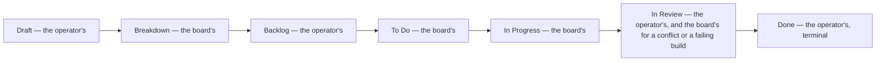

A ticket crosses the same run of columns on the stock board, and each is
somebody's to move it out of — the operator's or the board's own. This is the
stock board; an operator's own may add a column, rename one or move it,
since nothing here is true of just one installation.



One increment of the loop is one trip through the middle of that run: it asks
the board for work, a session does it, and the ticket moves.

```mermaid
sequenceDiagram
  participant Loop
  participant Board
  participant Session
  participant Ticket

  Loop->>Board: ask for work
  Board-->>Loop: clears a ticket, hands back a claim
  Loop->>Session: spawn
  Session->>Ticket: do the work, then move it
  Session-->>Loop: report what it cost
```
