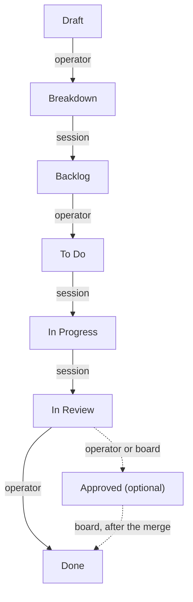
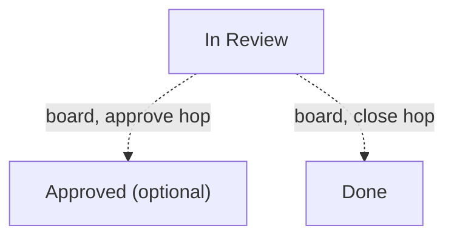

One ticket crosses the same run of columns from an idea to shipped work, and
each column is somebody's to move it out of. An operator may rename columns,
add more and reorder them, so nothing below depends on a name: each column is
described by what happens in it, and the names are only what a fresh install
calls them. [The board and its columns](the-board-and-its-columns) has the
columns themselves, and the flags that make each behave as it does.

## The seven stock columns

In order, left to right:

- **Draft** — an idea being written; nothing reads it. A person moves it on.
- **Breakdown** — a session turns the draft into a specification, with
  acceptance criteria on the issue and children under it, and moves it on.
- **Backlog** — specified work awaiting selection. It is the gate between
  "somebody wrote a paragraph" and "a pull request is open". A person moves it
  on.
- **To Do** — a session analyses the work until implementing it is mechanical,
  and moves it on.
- **In Progress** — a session writes the code, gets it green, pushes it and
  puts it up for review.
- **In Review** — the pull request is read, goes green and is merged. A person
  moves it on. A session steps in only for a pull request that has stopped
  merging cleanly or whose build has failed, and that increment starts and ends
  in the same column.
- **Done** — shipped, and terminal. Only a person moves work into it, or the
  board itself, carrying a pre-approved parent through once its children are
  done.

**Approved is not a stock column.** It is the optional eighth that a board adds
between review and Done, ticking **Protected** on it and then **Merges PR**. A
person moving a ticket into it by hand is the approval, and the runner then
merges once the branch is current and green. A board without one has review's
own person merge. [The board and its
columns](the-board-and-its-columns#example-an-approved-column) shows how to add
it, and [letting the loop merge for you](letting-the-loop-merge-for-you) covers
what has to be true before it merges with nobody watching.

Solid edges below are the seven stock columns and dashed edges the optional
eighth. The board may carry a ticket where the figure shows a person or a
session; those moves are [the hops](#the-hops-the-board-makes), covered below.

## Who moves it out

There are three answers to who moves a ticket out of a column:

- **A person.** Nothing else will.
- **A session.** Some playbook names the column as its `from` for that issue's
  type, so the loop dispatches a session to work the ticket there and move it
  on.
- **The board, with no session.** This is a hop: the board carries the ticket
  one step on by itself.

Which of these a column is comes from the [playbook](playbooks) matrix, never
from the column's name. A column no playbook names as its `from` is a person's,
and one column can be a session's for a story and a person's for an epic,
because a playbook names the issue types it applies to. Rename **Breakdown** to
anything you like and it is still a session's; add a column nobody writes a
playbook for and it is a person's.
[Who moves work](the-board-and-its-columns#who-moves-work) says the same from
the board's side, and [Issues](issues) is what travels with the ticket as it
crosses.

## The hops the board makes

A hop is the board carrying a ticket with no session, on its own say-so. There
are seven kinds, and each is a condition and a landing column:

- **express** — an express issue, standing in
  a column ticked **Express skips** with no question unanswered. It is carried
  to the column a session there would have been sent to.
- **epic** — an epic short of the column where code gets written, with
  something filed under it. A sub-epic follows its parent epic once the parent
  has reached that column; a top-level epic is carried only by the move that
  lands it there, so the move off the backlog stays a person's. It lands one
  column on, as a session would have sent it.
- **under** — a story or bug standing in a column ticked **Express skips**
  whose parent epic has reached the column where code gets written. It is
  carried to the column a session there would have been sent to.
- **parent** — a child standing in a column ticked **Parent pulls**, whose
  parent has reached the column where code gets written, with no sibling
  already holding the pull and none of its own dependencies unmet. It is
  carried to the column a session there would have been sent to. Out of the
  column that feeds the one where code gets written it carries only a task
  under a story, never a story under an epic, and never a child whose brief is
  longer than the playbook there allows; those are analysed first.
- **sendback** — a childless issue standing right of the column that feeds the
  column where code gets written, whose brief is longer than its playbook
  allows. It is carried back to that feeding column.
- **approve** — a pre-approved issue in review with a pull request recorded
  that would merge cleanly or only needs bringing current. It is carried into
  the column ticked **Merges PR**.
- **close** — a pre-approved parent in review with no pull request recorded and
  every child done. It is carried into the first terminal column to review's
  right.

They are asked in that order, and the order matters: nothing that already
qualifies for an earlier kind changes meaning by qualifying for a later one.
Six of the seven carry a ticket on; **sendback** is the one kind that moves a
ticket **left**. [The board and its
columns](the-board-and-its-columns#who-moves-work) names the flags the
conditions read, and [letting the loop merge for
you](letting-the-loop-merge-for-you) covers pre-approval.

The approve and close hops are the board's own version of the two moves a
person makes by hand off review, dashed the same as the optional column above:

## What each move costs

The three movers are not priced alike, and the difference is the reason hops
exist:

- **A session** is a model, one increment, a budget and a work-log row.
- **A hop** is a write on the board's own say-so. No model runs, nothing is
  spent, and no work-log row is written, because a hop is not an increment.
- **A person's move** costs nothing, and waits for a person.
